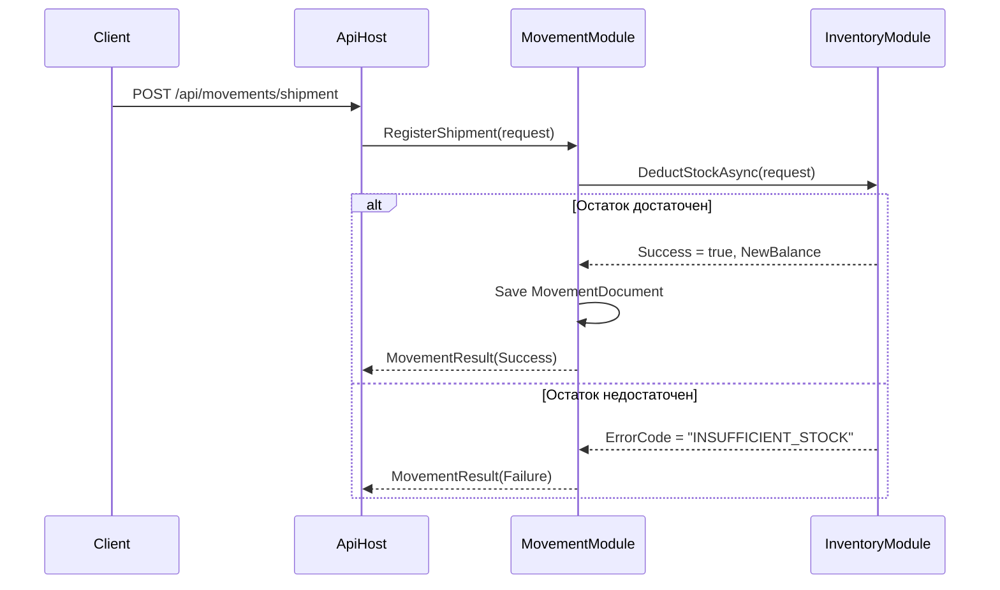

# Курсовое проектирование. Этап 3
**Тема:** Разработка и интеграция модулей проекта в режиме командной работы  
**МДК:** 02.02 «Инструментальные средства разработки программного обеспечения»    
**Основной стек:** C# / .NET 9, Git  

---

## 1. Цель этапа
Разработать и интегрировать два взаимодействующих модуля (`InventoryModule` и `MovementModule`) через зафиксированный контракт, обеспечить журналирование, покрыть граничные сценарии тестами и задокументировать процесс интеграции.

---

## 2. Исходное состояние репозитория
**Команда:** `git status`  
**Результат:** `On branch main, nothing to commit, working tree clean`  

**Команда:** `git log --oneline -3`  
**Результат:**
```
a0304fc (HEAD -> main, tag: v0.1.0-stage2) merge: complete stage 2 git configuration
de96541 merge: complete stage 1 artifacts
e39cc08 Initial commit
```

---

## 3. Выполненные действия

### 3.1. Создание рабочих веток (моделирование командной работы)
Для разделения ответственности созданы две ветки от `main`:
```bash
git checkout -b feature/inventory-module
git checkout -b feature/movement-integration
```

### 3.2. Фиксация контракта
Контракт взаимодействия зафиксирован в `src/WarehouseInventory.Contracts/IStockUpdateService.cs` до начала интеграции. Он включает методы `AddStockAsync` и `DeductStockAsync`, возвращающие `MovementResult`.

### 3.3. Реализация сценариев и журналирование
В `InventoryModule` реализована логика проверки остатков. Добавлено структурированное журналирование через `ILogger`:
```csharp
_logger.LogInformation("Attempting to deduct {Quantity} of item {ItemId} from warehouse {WarehouseId}", 
    request.Quantity, request.ItemId, request.WarehouseId);
```
Реализованы два сценария:
- **Успешный:** остаток уменьшается, возвращается `Success = true`.
- **Отрицательный:** при `Quantity > CurrentBalance` операция прерывается, возвращается `ErrorCode = "INSUFFICIENT_STOCK"`.

### 3.4. Тестирование
Добавлены тесты в соответствующие проекты:
1. **Модульный тест:** `DeductStock_InsufficientStock_ReturnsError` – проверяет, что при попытке списания большего количества, чем есть в наличии, возвращается ошибка `INSUFFICIENT_STOCK` без изменения баланса.
2. **Интеграционный тест:** `ReceiptThenShipment_UpdatesBalanceCorrectly` – проверяет сквозной сценарий: создание прихода, а затем расхода, с проверкой итогового остатка в тестовой базе данных (SQLite in-memory).

### 3.5. Схема потока данных (Data Flow)


### 3.6. Интеграционные проблемы и их устранение
**Проблема:** При первоначальной интеграции `MovementModule` создавал документ движения в БД *до* вызова `DeductStockAsync`. Если списание завершалось ошибкой `INSUFFICIENT_STOCK`, в системе оставался "висячий" (непроведенный) документ.  
**Решение:** Изменен порядок операций. Теперь вызов `DeductStockAsync` выполняется первым. Документ движения сохраняется в БД только после получения `Success = true` от `InventoryModule` (в рамках одной транзакции).

---

## 4. Самопроверка по требованиям

| Требование | Статус | Подтверждение |
|------------|--------|---------------|
| Два взаимодействующих модуля | Выполнено | `MovementModule` и `InventoryModule` |
| Контракт зафиксирован до объединения | Выполнено | Интерфейс в `Contracts` создан в первой ветке |
| Работа в отдельных ветках | Выполнено | `feature/inventory-module`, `feature/movement-integration` |
| Успешный и отрицательный сценарии | Выполнено | Реализованы в `StockUpdateService` |
| Журналирование с контекстом | Выполнено | Использован `ILogger` с параметрами `ItemId`, `Quantity` |
| Минимум 1 модульный тест | Выполнено | `DeductStock_InsufficientStock_ReturnsError` |
| Минимум 1 интеграционный тест | Выполнено | `ReceiptThenShipment_UpdatesBalanceCorrectly` |
| Схема потока данных | Выполнено | Раздел 3.5 отчёта |
| Описание интеграционных проблем | Выполнено | Раздел 3.6 отчёта |

---

## 5. Вывод
Модули разработаны и интегрированы через строгий контракт. Отрицательные сценарии обрабатываются корректно, журналирование позволяет отслеживать контекст операций. Интеграционная проблема с порядком сохранения данных решена изменением логики транзакции. Репозиторий готов к этапу отладки.